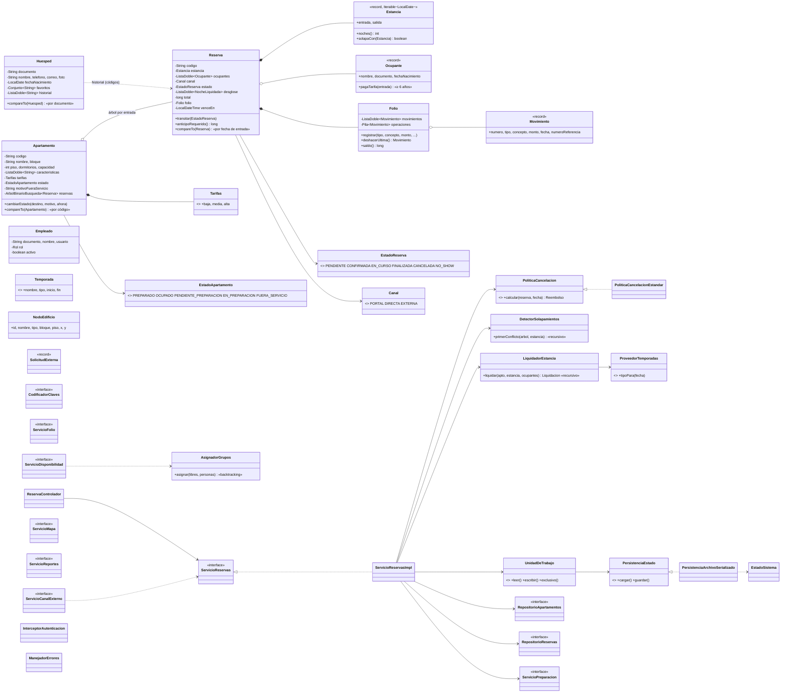

# Diagrama de clases

Arquitectura por capas (dependencias hacia adentro): **web → servicio → negocio / repositorio → dominio → estructuras**.

## Principios SOLID aplicados

| Principio | Cómo se cumple |
|---|---|
| **S** — Responsabilidad única | Cada clase hace una cosa: `LiquidadorEstancia` solo liquida, `DetectorSolapamientos` solo detecta choques, `PoliticaCancelacion` solo calcula reembolsos, los controladores solo traducen HTTP, el `Mapeador` solo convierte a DTO, `ManejadorErrores` solo traduce excepciones. |
| **O** — Abierto/cerrado | Nuevas políticas de cancelación, nuevos órdenes (`Comparator`) o un nuevo medio de persistencia se agregan implementando una interfaz, sin modificar los servicios. |
| **L** — Sustitución de Liskov | Todas las estructuras son intercambiables como `Coleccion<T>`; cualquier `PersistenciaEstado` o `Reloj` (el real o el de pruebas) funciona igual. |
| **I** — Segregación de interfaces | Repositorios pequeños y específicos (`RepositorioApartamentos`, `RepositorioTurnos`, …) y servicios por caso de uso en vez de un servicio gigante. |
| **D** — Inversión de dependencias | Los servicios dependen de abstracciones (`UnidadDeTrabajo`, repositorios, `Reloj`, `ProveedorTemporadas`, `CodificadorClaves`); Spring inyecta las implementaciones por constructor. |
