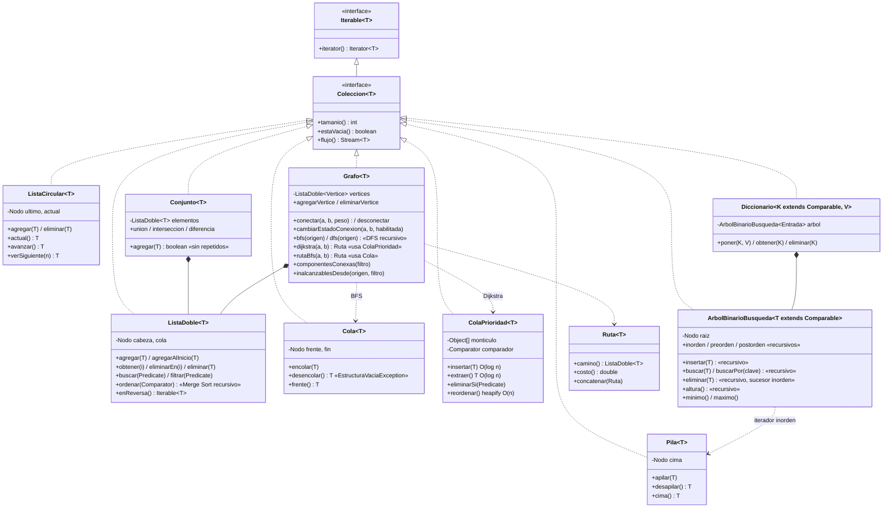

# Diagrama de estructuras propias

Todas las estructuras son genéricas, implementan `Iterable<T>` con su propio `Iterator<T>` (a través de
`Coleccion<T>`) y **no usan colecciones de `java.util`**. Paquete: `co.edu.uq.sga.estructuras`.

## Uso de cada estructura en el SGA

| Estructura | Dónde se usa |
|---|---|
| `Grafo<NodoEdificio>` * | Mapa del edificio (apartamentos, recepción, escaleras, cuartos de aseo, puente). Dijkstra/BFS para la ruta de preparación, DFS para agrupar por bloque, BFS para inalcanzables al cerrar un pasillo. |
| `ColaPrioridad<ItemPreparacion>` * | Cola de preparación: prioridad 1 = entrada hoy (por hora de llegada), prioridad 2 = resto (`ComparadoresPreparacion` con `thenComparing`). |
| `ColaPrioridad<Reserva>` * | Reservas Pendientes ordenadas por hora de vencimiento (24 h). |
| `Cola<SolicitudExterna>` * | Solicitudes del canal externo en orden de llegada (FIFO). |
| `Pila<Movimiento>` * | Deshacer la última operación del folio (registra el movimiento contrario). En Angular, `Pila<string>` para el botón "Atrás". |
| `ListaDoble<T>` * | Historial de estancias del huésped, ocupantes de una reserva, desglose de noches liquidadas, movimientos del folio. |
| `ListaCircular<String>` | Rotación de turnos de los recepcionistas. |
| `ArbolBinarioBusqueda<T>` * | Catálogo de apartamentos por código, huéspedes y empleados por documento, **reservas de cada apartamento por fecha de entrada**. |
| `Diccionario<K,V>` | Índice global de reservas por código y sesiones activas (sobre el ABB). |
| `Conjunto<String>` | Apartamentos favoritos de cada huésped (sin repetidos). |

## Algoritmos recursivos

- **ABB**: insertar, buscar, eliminar, altura, inorden/preorden/postorden.
- **Detección de solapamientos** (`DetectorSolapamientos`): recorre recursivamente el árbol de reservas de **un**
  apartamento; si una reserva entra en o después de la salida pedida, poda su subárbol derecho.
- **DFS** sobre el grafo (recorrido y componentes conexas).
- **Liquidación noche por noche** (`LiquidadorEstancia`): valor de esta noche + valor del resto, recorriendo la
  `Estancia` con su `Iterator`.
- **Merge Sort** de `ListaDoble`.
- **Asignación de grupos grandes con backtracking** (`AsignadorGrupos`): incluye/excluye cada apartamento libre,
  poda cuando la capacidad restante no alcanza o cuando ya no puede mejorar el mínimo de apartamentos.
